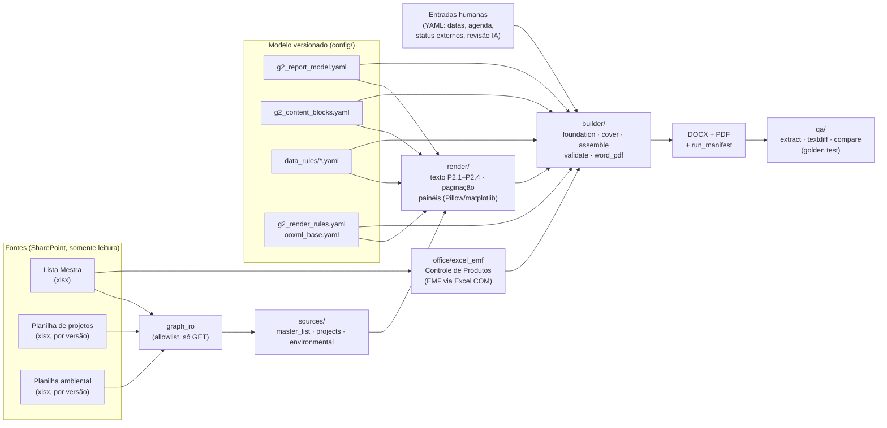

# Relatório Técnico Automatizado

> **Summary in English.** A Python system that rebuilds, from an empty `Document()`, a
> ~43-page monthly engineering and environmental report for a road-infrastructure program
> (four highways, six deliverable "products", per-highway dashboards, an annex index). It was
> built by reverse-engineering 14 published editions: every component of the report was traced
> to its source (a master list spreadsheet, a projects workbook, an environmental workbook on
> SharePoint), its transformation and its layout, and recorded as a versioned, validated model
> (YAML) with evidence and confidence levels. Text, tables, EMF tables exported by Excel and
> reconstructed charts are rendered deterministically; a golden-test comparator (strict text
> diff, facts, pages, raster regions) checks the generated PDF against the published one, and
> every accepted difference must cite a catalogued historical defect or a design decision.
> SharePoint access is read-only by construction (closed allowlist, GET only, AST-checked).
> Built by Emmily Maciel with Claude Code/Codex as coding assistants under her review.

Sistema em Python que **gera do zero** o relatório técnico mensal de um programa de
infraestrutura rodoviária — consolidando medições, pareceres, status de projetos e licenças
ambientais por rodovia — a partir das planilhas de controle no SharePoint, sem abrir o Word do
mês anterior.

> **Dados fictícios.** Versão sanitizada de um sistema em uso real; identificadores do cliente
> foram substituídos (programa → "Programa", rodovias → `RD-101`…`RD-104`, empresas e órgãos
> → nomes genéricos). Planilhas, PDFs, catálogos do acervo e IDs do SharePoint foram removidos.

---

## Problema

Todo mês a equipe produzia à mão um relatório de ~43 páginas: capa, apresentação, resumo
executivo, seis produtos com quadros de "Controle de Produtos", quadros de status de disciplinas
por rodovia, painéis ambientais, agenda de reuniões, encerramento com contagem de páginas e
anexos. O processo era "copiar o Word anterior e trocar os dados", o que gerava erros que se
propagavam de mês a mês — o catálogo do projeto registra **101 anomalias históricas**
(`data/catalog/anomalies.jsonl`), como número do relatório copiado do mês anterior, mês de
referência errado, frases truncadas e grafias inconsistentes de rodovias.

## Solução

1. **Fase A — descoberta e certificação (uma vez).** Engenharia reversa dos relatórios
   publicados (DOCX/PDF), da Lista Mestra e das planilhas: para cada componente, fonte, regra
   de seleção, transformação, representação e posição, com evidência e nível de confiança.
   O resultado é um **modelo versionado** (`config/g2_report_model.yaml` + blocos de conteúdo,
   regras de dados, regras de render, base OOXML), validado por código (`prog_g2_report.model`).
2. **Fase B — produção mensal.** Um comando gera DOCX + PDF do relatório N a partir do modelo e
   das fontes daquele mês, roda validações (número/mês coerentes, nenhum documento fora da
   Lista Mestra, contagens) e emite uma pauta de revisão humana para os trechos interpretativos.

Princípios que guiam o código:

- **A Lista Mestra é o manifesto** — nada entra no relatório que não esteja nela (DEC-006).
- **Texto citado é preservado; texto gerado é padronizado** (DEC-007): erros históricos são
  catalogados e nunca "aprendidos" como regra.
- **Snapshot pelo instante de publicação** para reconstruções históricas (DEC-012).
- **Trechos de síntese (IA) só entram revisados por humano**; sem chamada de API no builder (DEC-013).
- **SharePoint somente leitura**, garantido em três camadas e por teste que lê a AST (DEC-001).

## Arquitetura



| Pacote | Responsabilidade |
|---|---|
| `prog_g2_report/sharepoint` | autenticação MSAL (client secret em `SecretStr`), cliente Graph read-only com allowlist |
| `prog_g2_report/security` | guarda de caminhos: recusa escrita em pastas sincronizadas com o SharePoint |
| `prog_g2_report/sources` | leitura das planilhas (local ou por versão, em memória) |
| `prog_g2_report/model.py` | validador do modelo (Gate B em código): coerência entre YAMLs, catálogo de anomalias, literais proibidos |
| `prog_g2_report/render` | renderizadores de texto por produto, paginação, painéis reconstruídos |
| `prog_g2_report/office` | exportação EMF do Excel via COM (Windows) |
| `prog_g2_report/builder` | montagem OOXML a partir de documento vazio, capa, validações, conversão PDF |
| `prog_g2_report/qa` | extrator de fatos do PDF, diff de texto estrito, comparador do golden test, mutações |
| `scripts/` | pipeline numerado da descoberta (01–13) à geração mensal (15–17) |

Decisões de arquitetura: [`docs/decisions/`](docs/decisions/) (DEC-001 a DEC-015).
Runbook mensal: [`docs/PRODUCAO_MENSAL.md`](docs/PRODUCAO_MENSAL.md).

## Números

Fonte: [`STATE.md`](STATE.md), `docs/qa/GATES.md` e catálogos em `data/catalog/`.

| Indicador | Valor | Fonte |
|---|---|---|
| Relatórios históricos analisados na descoberta | nº 01 a nº 14 | `config/project.yaml`, `docs/decisions/DEC-005` |
| Golden test do nº 14 | **PASS** — 43/43 páginas, fatos críticos 100% (180/181 fatos no QA de fontes), anexos 100% (149), 0 diferença visual MAJOR | `STATE.md` |
| Diferenças de texto aceitas no golden nº 14 | 113, todas justificadas por anomalia catalogada ou DEC | `STATE.md` |
| Anomalias históricas catalogadas | 101 | `STATE.md`, `data/catalog/anomalies.jsonl` |
| Gates | A (linhagem) PASS · B (modelo) PASS · D (nº 14) PASS · E (certificação) pendente | `STATE.md` |
| Modelo | `G2_REPORT_MODEL` v0.14, `BUILDER_READY` (ainda não `CERTIFIED`) | `STATE.md` |
| Suíte offline | > 1000 testes verdes (verificação de 2026-10-04 no repositório de origem) | `STATE.md` |

## Como rodar

Requisitos: Python 3.12+. A geração completa do relatório exige Windows + Excel + Word
(exportação EMF e atualização de campos via COM) e as planilhas reais — **não incluídas** nesta
versão pública. O que roda aqui é a suíte offline, com fixtures sintéticas:

```powershell
python -m venv .venv
.venv\Scripts\python -m pip install -e ".[dev,discovery]"
.venv\Scripts\python -m pytest                 # offline; -m office / -m golden / -m network ficam de fora
```

- Fixtures fictícias: `tests/fixtures/` (PDFs sintéticos do golden, catálogo de mutações,
  `golden_inputs_example.yaml` com o formato das entradas humanas).
- Testes que dependiam de dado real do contrato foram marcados como `skip` (ver relatório de
  sanitização); os marcados `golden`/`office`/`network` já pulam sem evidência local.
- Para uso real, copie `.env.example` para `.env` (tenant, client id e secret do app do Entra ID)
  e siga `docs/PRODUCAO_MENSAL.md`; o comando mensal é
  `scripts/17_generate_report.py --report-number N --reference-month AAAA-MM --inputs <yaml> --master-list <xlsx>`.

## Limitações conhecidas

- A geração completa exige **Windows + Excel + Word** (EMF e atualização de campos via COM) e as planilhas reais, que não acompanham esta versão; aqui roda a suíte offline, com 297 testes pulados pelos marcadores `office`/`golden`/`network`.
- O modelo está em `BUILDER_READY` (v0.14), ainda não `CERTIFIED`: o Gate E (certificação) está pendente (`STATE.md`).
- Trechos de síntese dependem de revisão humana; não há chamada de API de IA no builder (DEC-013).
- O golden test foi aprovado para o relatório nº 14; reconstruções históricas dependem do snapshot das fontes no instante de publicação (DEC-012).
- Efeito da sanitização: os identificadores fictícios `RD-101` e `RD-103` diferem num só dígito, e a checagem de painel trocado pelo selo visual não detecta troca entre painéis `RD-10x` nesta cópia (a legenda e a grade continuam detectando).

## O que eu decidi × o que a IA gerou

O código foi escrito com **Claude Code** (e Codex) como assistentes, sob direção e revisão
minhas. A divisão, conforme registrada nas DECs e no `STATE.md`:

| Eu decidi | A IA gerou sob minha revisão |
|---|---|
| Gerar do zero a partir de `Document()`, nunca editar o relatório anterior | Montagem OOXML, estilos, numeração, seções e capa (`builder/`) |
| SharePoint estritamente read-only, com allowlist e teste por AST (DEC-001) e autenticação por client secret (DEC-004) | Cliente Graph, guarda de caminhos e testes de segurança |
| Lista Mestra como manifesto e regra de seleção pelo campo "N° Relatório" (DEC-006) | Leitores de planilha e renderizadores por produto |
| Separação texto citado × texto padronizado e a forma única do número do contrato (DEC-007) | Catálogo de anomalias e a varredura que impede reintroduzi-las |
| Controle de Produtos como EMF vetorial exportado pelo próprio Excel (DEC-010) e painéis reconstruídos a partir do dado (DEC-009) | Exportador COM, painéis em Pillow/matplotlib |
| Snapshot das fontes pelo instante de publicação (DEC-012) | Comparador do golden test (diff estrito, fatos, raster) e mutações adversariais |
| Slots de síntese sempre com revisão humana, sem chamada de API (DEC-013); assinatura digital fora do builder (DEC-014) | Rascunho determinístico por palavras-chave e a pauta de revisão |
| Critério de aceite: cada diferença no golden precisa citar anomalia ou DEC; certificação v1.0 só com minha aprovação | Subagentes de investigação (`.claude/agents/`) e relatórios de QA |

## Stack

Python 3.12 · python-docx / lxml (OOXML) · openpyxl · PyMuPDF / pdfplumber · Pillow ·
matplotlib · pywin32 (Excel/Word COM) · MSAL + httpx (Microsoft Graph) · pydantic-settings ·
PyYAML · pytest · ruff · Claude Code / Codex (assistentes de código).

## Verificação, sanitização e licença

- **Testes:** `py -3.12 -m pytest tests -q -p no:cacheprovider` → **1068 passed, 297 skipped** (marcadores office/golden/network) em 19/11/2026.
- **Dados:** fictícios — cópia sanitizada de um sistema em uso real; nenhum dado de cliente ou de terceiro.
- **Sanitização:** o que foi removido, trocado ou inventado nesta cópia está em [`SANITIZACAO.md`](SANITIZACAO.md).
- **Licença:** todos os direitos reservados; leitura permitida para avaliação de portfólio — ver [`LICENSE`](LICENSE) e [`NOTICE`](NOTICE).

---

Autora: **Emmily Maciel** — [github.com/Emmilymaciell](https://github.com/Emmilymaciell).

*Dados fictícios. Versão sanitizada de um sistema em uso real; identificadores do cliente foram substituídos.*
